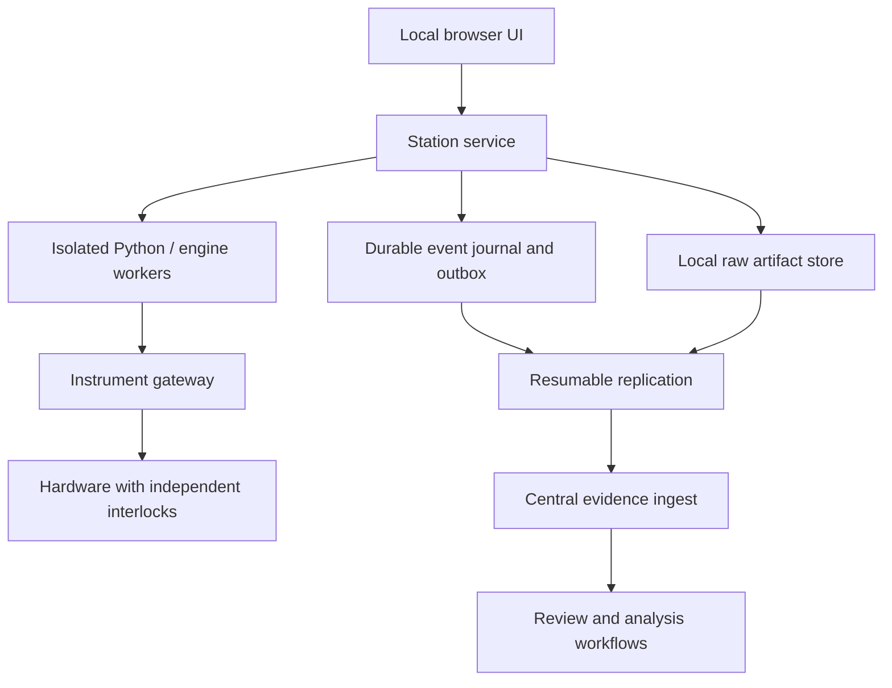

# Proposed TestForge architecture

Status: proposed; no implementation or qualification implied. Requirements are in [the catalog](../requirements/REQUIREMENTS.md). The [original baseline](../archive/BASELINE_V0.1.md) contains the fuller lifecycle and acceptance campaigns.

## Deployment and authority

The station serves all browser assets locally. One station owns a run and its hardware resources. Operator and witness can use separate browser sessions on an isolated LAN, but share one execution authority. Remote observers do not acquire command rights.

SQLite is a candidate journal, not a guarantee by itself: choose and verify flush behavior, filesystem/storage assumptions, disk reserve, corruption response and coordinated artifact backup. Keep large raw artifacts outside bounded document blobs. A time-series database may index data without becoming the only surviving copy of raw evidence. Diagnostic logs and OpenTelemetry, if adopted, supplement rather than replace the evidence journal.

## Prepared execution package

Freeze procedure revision, stable step IDs, scripts and dependencies, limit/decision rules, required documents, instrument mappings, calibration references and bounded identity grants. Verify package completeness and signatures before declaring offline readiness. A central outage must not block already prepared work; expired authority, missing local evidence storage or missing safety prerequisites must.

## Local transaction boundary

Persist accepted human input, signatures, transitions and measurements before acknowledging them in the UI. Store the event and its upload obligation in the same local transaction. Complete artifact writes through a staged-file/manifest protocol that detects incomplete data after a crash. Replication is asynchronous whether the network is healthy or absent.

The transaction cannot include the physical instrument. Record command intent and operation ID before dispatch, then record observed outcome. If a process fails after dispatch but before durable outcome, the result is **unknown**, not automatically failed or safe to retry. Recovery requires observation, a device-specific idempotency mechanism where genuinely supported, or authorized disposition. A generic workflow retry must never blindly resend physical actions.

## Synchronization contract

Events carry stable IDs, per-run sequence, actor, station identity, revision context and integrity information. Repeated uploads of identical events deduplicate; the same ID with different content is rejected and retained for investigation. Large artifacts use resumable chunks plus final size/hash validation. Central receipt is complete only when required event sequences, signatures and artifacts validate.

Preserve conflicting signed records. Do not apply last-writer-wins to approvals or results. Reconcile later-discovered role revocation, calibration recall and changed references into explicit review tasks. Keep local evidence until central receipt and configured backup/retention gates succeed.

Offline ownership is a bounded grant, not a short central lease whose expiry automatically permits a second station to command hardware. A failed-station handoff needs release or physical isolation; ownership epochs reject stale controllers when communication resumes.

## Lifecycle dimensions

| Dimension | Examples | Why separate |
|---|---|---|
| Procedure | Draft, reviewed, released, superseded | Editing the master must not mutate a historical run |
| Execution | Ready, running, held, aborted, completed | Completed execution may contain failures |
| Verdict | Pass, fail, invalid, unknown, not verified | A waiver must not rewrite a measurement as pass |
| Replication | Local only, queued, uploading, reconciled, conflicted | Uploading metadata does not prove all evidence arrived |
| Review | Pending, rejected, approved, stale | Changed evidence invalidates affected approval |
| Analysis | Pending tasks, generated, reviewed, accepted | Analysis can finish after execution |
| Closure | Open, provisionally reviewed, closed, amended | Final acceptance requires all configured gates |

Signatures bind actor, role, meaning, policy, time and the exact revision/evidence digest. A single identity with two roles does not satisfy an independent operator/QA requirement. Run-only redlines remain distinct from master revisions. Retests create new attempts; corrections append provenance. Closed records change through controlled amendments.

## Integration choices remain open

- OpenTAP or OpenHTF behind a versioned execution adapter.
- Python workers with pinned environments and resource limits.
- VISA, serial, USB and vendor-specific adapters with matching simulators; not every USB device speaks VISA.
- Frappe as a candidate central authoring/review framework.
- Loom components only after review of a current pinned revision and fit for the intended storage role.
- External calibration systems through provenance-preserving snapshot adapters.
- Optional analysis/telemetry backends through explicit evidence identifiers and export contracts.

An orchestration engine can manage waiting and human review, but it cannot create exactly-once physical behavior. Selection of a general workflow framework is a separate decision from instrument command recovery.

## Proposed capacity targets

Seven disconnected days, 10,000 procedure steps, 100 structured events/second per station, a 10 GB artifact, p95 local action acknowledgment below 500 ms excluding instrument latency, and UI recovery within 60 seconds are initial **proposals**, not measured capabilities or settled project needs. Replace them with an approved workload before qualification. Structured event rate is not a raw waveform throughput claim.
